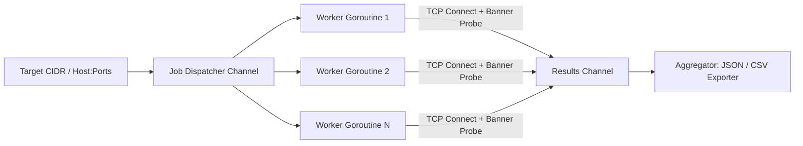

# PortScanner

**High-Throughput Concurrent TCP Port Scanner in Go**

[](https://github.com/ispectr3/portscanner/actions/workflows/ci.yml)
[](LICENSE)
[](https://golang.org)

PortScanner is a high-performance network reconnaissance utility written in Go. Utilizing Go's native goroutine concurrency and worker pool architecture, it rapidly scans target IP addresses and CIDR network blocks with banner grabbing and structured data export (JSON/CSV).

---

## Concurrency Model



---

## Features

- **Concurrent Worker Pool**: Configurable concurrency (`-threads`, default: 100 goroutines) with non-blocking channel distribution.
- **CIDR & Subnet Scanning**: Automatically expands IPv4 subnets (e.g. `192.168.1.0/24`) into discrete scanning jobs.
- **Service Banner Grabbing**: Probes responsive ports with HTTP and protocol handshakes to extract daemon versions.
- **Port Selection**: Supports comma-separated lists (`80,443`), ranges (`1-1024`), or curated top-ports (`top100`).
- **Structured Output**: Direct export to JSON or CSV for automated vulnerability scanner ingestion.

---

## Installation

### Prerequisites

- Go 1.21+

```bash
git clone https://github.com/ispectr3/portscanner.git
cd portscanner
go build -o portscanner main.go
```

---

## Usage

```bash
./portscanner -host <target> [flags]
```

### Examples

```bash
# Scan a single host for top 100 ports
./portscanner -host 192.168.1.10 -ports top100

# Scan a port range with 250 threads
./portscanner -host 10.0.0.1 -ports 1-1000 -threads 250

# Scan an entire subnet and export to JSON
./portscanner -host 192.168.1.0/24 -ports 80,443,8080 -format json -output results.json
```

---

## Automated Testing

```bash
go test -v ./...
```

---

## License

PortScanner is open-source software licensed under the [MIT License](LICENSE).
